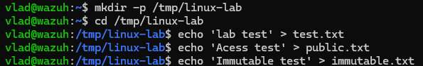
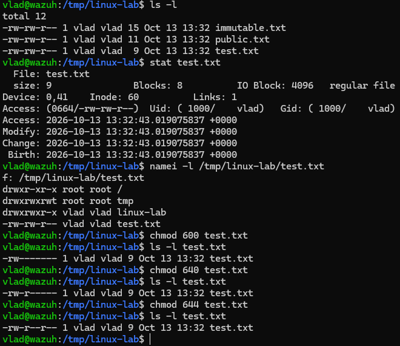
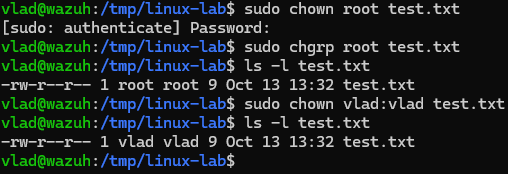
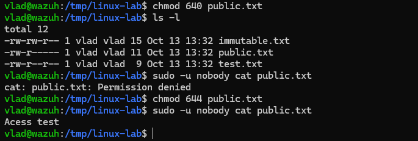
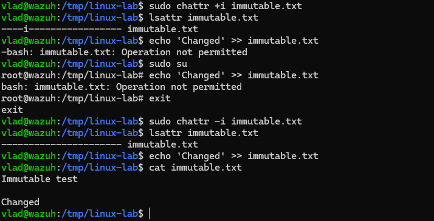

# Linux: права доступа, владельцы и метаданные

## Цель

Разобраться с правами файла и каталога, владельцем и группой, а также научиться искать причину `Permission denied`.

## Что использовали

- `ls -l`, `ls -ld` — посмотреть права, владельца и группу.
- `chmod` — изменить права.
- `chown`, `chgrp` — изменить владельца и группу.
- `stat` — посмотреть inode и временные метки.
- `namei -l PATH` — проверить каждый каталог в пути.
- `sudo -u USER COMMAND` — проверить доступ от имени другого пользователя.
- `chattr`, `lsattr` — установить и посмотреть атрибуты файла.

## Основное

Для файла `r` — читать, `w` — изменять, `x` — выполнять. Для каталога `r` позволяет смотреть список имён, `w` — менять записи каталога, `x` — проходить через него и обращаться к объекту по известному имени.

Удаление файла обычно зависит от прав на родительский каталог, а не только от прав самого файла.

|Режим|Права|
|---|---|
|`600`|`rw-------`|
|`640`|`rw-r-----`|
|`644`|`rw-r--r--`|
|`664`|`rw-rw-r--`|
|`711`|`rwx--x--x`|
|`755`|`rwxr-xr-x`|

`chmod` меняет права, `chown` — владельца, `chgrp` — группу. Inode содержит метаданные объекта, а имя файла связывается с inode через запись каталога. Жёсткие ссылки указывают на один inode.

В `stat`:

- `atime` — время доступа к содержимому;
- `mtime` — время изменения содержимого;
- `ctime` — время изменения метаданных, не время создания;
- `Birth` — время создания, если поддерживается.

## Практика: 
## 1) Создание лаборатории
Создаем директорию командой mkdir -p (если папки нет, то она создается), далее меняем рабочий каталог, и создаем в нем три тестовых  файла.
```bash
mkdir -p /tmp/linux-lab
cd /tmp/linux-lab
echo 'lab test' > test.txt
echo 'Acess test' > public.txt
echo 'Immutable test' > immutable.txt
```

## 2) Проверка прав и метаданных
Проверяем, что файлы создались. С помощью `stat` смотрим метаданные файла, а `namei -l` позволяет проверить права каждого каталога в пути к нему. Затем меняем права доступа к `test.txt` и смотрим, как меняется их отображение.
```bash
ls -l
stat test.txt
namei -l /tmp/linux-lab/test.txt

chmod 600 test.txt
ls -l test.txt
chmod 640 test.txt
ls -l test.txt
chmod 644 test.txt
ls -l test.txt
chmod 664 test.txt
ls -l test.txt
```

## 3) Смены владельца и группы
Меняем владельца и группу разными командами, проверяем. И возвращаем как было.
```bash
sudo chown root test.txt
sudo chgrp root test.txt
ls -l test.txt
sudo chown vlad:vlad test.txt
ls -l test.txt
```

## 4) Проверка доступа от имени другого пользователя
С помощью `sudo -u nobody` проверяем, может ли другой пользователь читать файл. Сначала ограничиваем права до `640`, затем возвращаем чтение для остальных — `644`.
```bash
chmod 640 public.txt
ls -l
sudo -u nobody cat public.txt
chmod 644 public.txt
sudo -u nobody cat public.txt
```


## 5) Проверка атрибута immutable
Командой `chattr +i` устанавливаем атрибут неизменяемости файла. Проверяем его через `lsattr` и пробуем дописать данные. Затем снимаем атрибут и повторяем запись.
```bash
sudo chattr +i immutable.txt
lsattr immutable.txt
echo 'Changed' >> immutable.txt
sudo su
echo 'Changed' >> immutable.txt
exit
sudo chattr -i immutable.txt
lsattr immutable.txt
echo 'Changed' >> immutable.txt
cat immutable.txt
```

