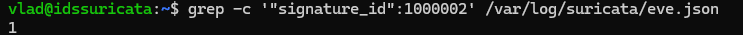

# Обнаружение syn_scan используя Suricata. 
## Стенд:
**Атакующий:** Kali Linux, 192.168.10.10
**Цель:** Ubuntu Server (Suricata IDS), 192.168.10.2
# Механизм детекта: syn_scan (Nmap -sS)
Реализация кастомного правила Suricata для обнаружения полуоткрытого сканирования портов.
# Воспроизведение атаки
Команда запуска сканирования с машины атакующего:
```bash
sudo nmap -sS 192.168.10.2
```
*Логика*: сканирование с флагом -sS без дополнительных ключей - это сканирование 1000 самый популярных портов.
# Сигнатура Suricata
```suricata
alert tcp any any -> $HOME_NET any (msg:"SYN_SCAN_DETECTED"; flags:S; threshold: type both, track by_src, count 10, seconds 5; sid:1000002; rev:1;)
```
*Логика:* Первые 9 пакетов идет подсчет в памяти и не пишет в eve.json но в логах ничего нет. На 10-м пакете порог пройден, будет выдан алерт, при этом в режиме type_both будет зафиксирован 1 алерт, даже если уже было просканировано 150 портов за один раз.
### Проверка правила
```bash
sudo suricata -T -c /etc/suricata/suricata.yaml -v
```
### Результат
#### Текстовая команда** + её вывод:

```bash
vlad@idssuricata:~$ grep -c '"signature_id":1000002' /var/log/suricata/eve.json
1
```
В логе Suricata используется слово *`signature_id`*, поэтому в правиле пишем sid:1000002 
### Скрин



