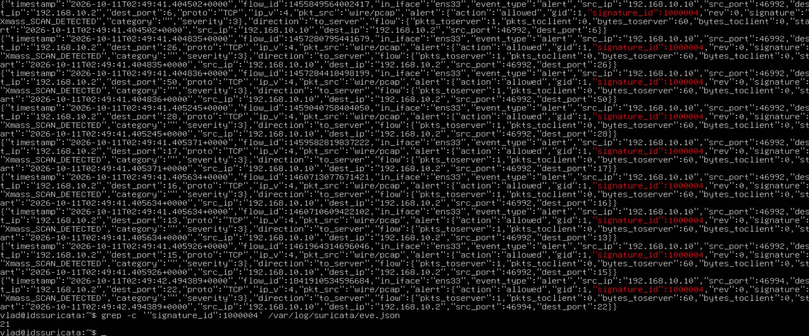

# Обнаружение xmas_scan используя Suricata.

## Теория:

### Xmas-сканирование

Xmas scan — метод сканирования портов, который использует **Nmap** для определения их состояния. При Xmas scan **Nmap** отправляет TCP-пакет с тремя флагами: `FIN`, `PSH` и `URG`, после чего анализирует ответ целевого хоста. В зависимости от состояния порта возможны следующие варианты:

#### Открытый порт

При стандартном поведении целевой хост не отвечает на TCP-пакет без установленных флагов. Поэтому **Nmap** не может однозначно определить, открыт порт или трафик фильтруется.

#### Закрытый порт

Целевой хост отвечает пакетом `RST`, указывая, что порт закрыт.

#### Фильтруемый порт

Если ответ отсутствует **Nmap** может определить порт как open|filtered.

## Стенд

**Атакующий:** Kali Linux, 192.168.10.10  
**Цель:** Ubuntu Server (Suricata IDS), 192.168.10.2

## Механизм детекта: xmas_scan (Nmap -sX)

Обнаружение `-sX` сканирования портов.

## Воспроизведение атаки

Команда запуска сканирования с машины атакующего:

```bash
sudo nmap -sX -Pn -p 1-50 192.168.10.2
```

_Логика_: `-sX` — сканирование с TCP-флагами `FIN`, `PSH` и `URG`. Ключ `-Pn` отключает предварительное обнаружение хоста, а `-p 1-50` задаёт сканирование TCP-портов с 1 по 50
## Сигнатура Suricata

```
alert tcp any any -> $HOME_NET any (msg:"XMAS_SCAN_DETECTED"; flags:FPU; detection_filter: track by_src, count 30, seconds 10; sid:1000004; rev:1;)
```

_Логика:_ Правило обнаруживает TCP-пакеты с флагами FIN, PSH и URG. detection_filter отслеживает количество совпадений от одного источника за 10 секунд. Первые 30 совпадений учитываются, но алерты не создаются. Начиная с 31-го совпадения правило создаёт алерт на каждый последующий пакет, если условие порога выполняется. Значит в нашем эксперименте должно сработать правило 20 раз т.е. с 31-го по 50-ый пакет.

В нашем эксперименте правило сработало 21 раз. Nmap проверял порты с 1 по 50, но на порт 22 отправил две пробы, поскольку ответа не было. В итоге получилось 51 совпадение, а алерты были созданы на совпадения с 31-го по 51-е включительно

## Проверка правила

```
sudo suricata -T -c /etc/suricata/suricata.yaml -v
```

## Результат

### Текстовая команда + её вывод

```
vlad@idssuricata:~$ grep -c '"signature_id":1000004' /var/log/suricata/eve.json
21
```


