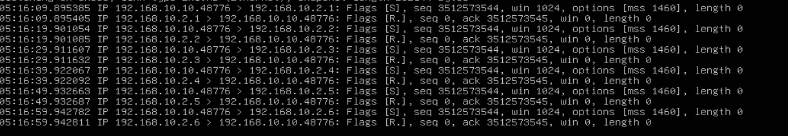
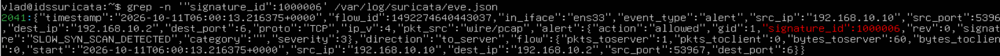

# Обнаружение slow_syn_scan используя Suricata.

## Теория:

### Slow SYN scan

Slow SYN scan — сканирование портов с помощью **Nmap** (`-sS`) с увеличенным интервалом между отправляемыми пробами. В сценарии используется параметр `--scan-delay 10s`, то есть примерно одна проба раз в 10 секунд. Цель — проверить, сможет ли медленное сканирование избежать срабатывания правил обнаружения, основанных на пороге частоты событий.

**Атакующий:** Kali Linux, 192.168.10.10  
**Цель:** Ubuntu Server (Suricata IDS), 192.168.10.2

## Механизм детекта: slow_syn_scan (Nmap -sS)

Обнаружение медленного `-sS` сканирования портов.

## Воспроизведение атаки

Команда запуска сканирования с машины атакующего:

```bash
sudo nmap -sS -Pn -r --scan-delay 10s -p 1-6 192.168.10.2
```

_Логика_: SYN-сканирование портов. Ключ `-Pn` отключает предварительное обнаружение хоста, `-r` задаёт последовательный порядок сканирования портов, `--scan-delay 10s` устанавливает минимальную задержку между пробами, а `-p 1-6` задаёт сканирование портов с 1 по 6.
## Сигнатура Suricata

```suricata
alert tcp any any -> $HOME_NET any (msg:"SLOW_SYN_SCAN_DETECTED"; flags:S; detection_filter: track by_src, count 5, seconds 60; sid:1000006; rev:1;)
```

_Логика:_ Правило обнаруживает TCP-пакеты с флагом `SYN`. `detection_filter` отслеживает количество совпадений от одного источника за 60 секунд. Первые 5 совпадений учитываются, но алерты не создаются. Начиная с 6-го совпадения правило создаёт алерт на каждое последующее совпадение, пока выполняется условие порога.

В нашем эксперименте Nmap проверил 6 портов, отправляя SYN-пробы примерно с интервалом 10 секунд. По временным меткам `tcpdump` между первой и шестой пробами прошло около 50 секунд. Поэтому все 6 проб уложились в окно 60 секунд, и правило сработало один раз.

## Проверка правила

```bash
sudo suricata -T -c /etc/suricata/suricata.yaml -v
```

## Результат

### Текстовая команда + её вывод + проверка с TCPDUMP

```
vlad@idssuricata:~$ grep -c '"signature_id":1000006' /var/log/suricata/eve.json
1
```






