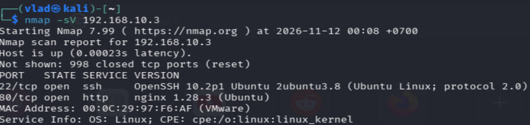
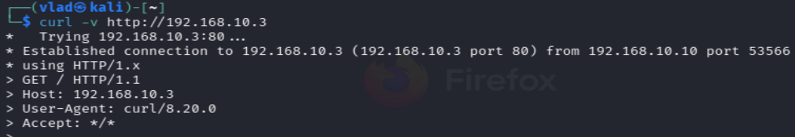
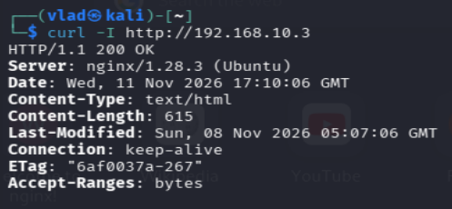
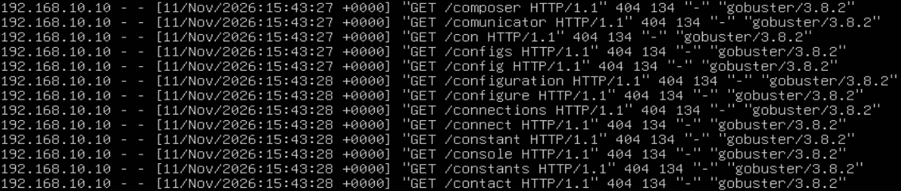

# HTTP — анализ запросов и сканирование Nginx

## Стенд

- **Kali Linux (192.168.10.10)** — отправка HTTP-запросов и сканирование.
- **Ubuntu Server (192.168.10.3)** — установлен веб-сервер Nginx.

## Цель

Разобраться с методами HTTP, кодами ответа сервера и посмотреть, как обычные запросы и сканирование Gobuster отображаются в логах Nginx.

## 1. Разведка Nmap

Сначала проверяем, какие порты открыты на Ubuntu Server.

```bash
nmap -sV 192.168.10.3
```

Параметр `-sV` используется для определения сервисов и их версий на обнаруженных портах.

В результате получили:

- `22/tcp` — OpenSSH 10.2p1
- `80/tcp` — nginx 1.28.3



## 2. HTTP-запросы через curl

С помощью curl проверяем, как Nginx обрабатывает HTTP-запросы.

### GET-запрос

```bash
curl -v http://192.168.10.3
```

`-v` (verbose) — подробный вывод информации о соединении, отправленных запросах и ответах сервера. Метод GET используется по умолчанию.

В выводе видим:

- `GET / HTTP/1.1` — запрос главной страницы.
- `Host: 192.168.10.3` — адрес целевого сервера.
- `User-Agent: curl/8.20.0` — информация о клиенте.

Сервер возвращает `200 OK` и HTML-код страницы.



### HEAD-запрос

```bash
curl -I http://192.168.10.3
```

`-I` — отправляет HEAD-запрос и выводит заголовки ответа без тела страницы. Если добавить `-v`, получим подробную информацию об обмене.

В результате сервер вернул:

- `200 OK` — успешная обработка запроса.
- `Server: nginx/1.28.3 (Ubuntu)` — версия веб-сервера.
- `Content-Type: text/html` — тип содержимого.
- `Content-Length: 615` — размер тела, которое сервер отправил бы при GET.



Также отправляли GET-запрос к несуществующей странице `/test123`. В ответ получили `404 Not Found`.

## 3. Сканирование Gobuster

Далее используем Gobuster для поиска каталогов и файлов на Nginx. Gobuster перебирает имена ресурсов из словаря и отправляет HTTP-запросы к серверу.

```bash
gobuster dir -u http://192.168.10.3 -w /usr/share/wordlists/dirb/small.txt -t 2 --delay 200ms
```

**Разбор команды:**

- `dir` — режим поиска каталогов и файлов.
- `-u` — URL веб-сервера, который сканируем.
- `-w` — путь к словарю с именами ресурсов.
- `-t 2` — используем два параллельных потока.
- `--delay 200ms` — пауза 200 мс между запросами каждого потока.


На скриншоте команда набрана без `dir`. Выше указан корректный синтаксис для Gobuster 3.x.

Использовали словарь примерно на 900 записей. После проверки около 250 вариантов сканирование остановили. Большинство запросов вернули `404 Not Found`. Отдельный запрос к `/` получил `200 OK`.

## 4. Анализ логов Nginx

Переходим на Ubuntu и открываем `access.log`.

В журнале видим большое количество GET-запросов к различным ресурсам, например:

- `/composer`
- `/config`
- `/configuration`
- `/connect`

Все эти запросы получили ответ `404`. Также в логах присутствует User-Agent `gobuster/3.8.2`.



По User-Agent можно предположить, какой инструмент отправлял запросы. Но заголовок формируется клиентом и может быть изменён.

Поэтому при анализе обращаем внимание не только на User-Agent, но и на количество запросов, частоту, запрашиваемые URI и HTTP-коды.

## 5. MITRE ATT&CK

**T1595.003 — Active Scanning: Wordlist Scanning**

Gobuster выполняет перебор ресурсов по словарю. Такая активность может использоваться на этапе разведки для поиска доступных каталогов и файлов.

## Вывод

Разобрали основные HTTP-методы GET и HEAD, коды ответа сервера и параметры curl.

С помощью Gobuster выполнили сканирование Nginx и посмотрели, как запросы отображаются в `access.log`.

По журналам можно обнаружить признаки автоматизированного сканирования. Однако само сканирование не означает, что атакующему удалось получить доступ к серверу или эксплуатировать уязвимость.
