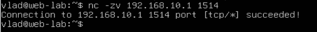
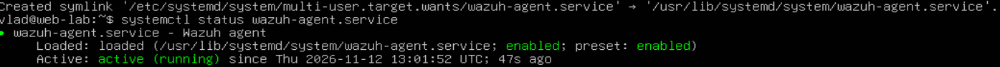
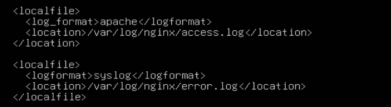
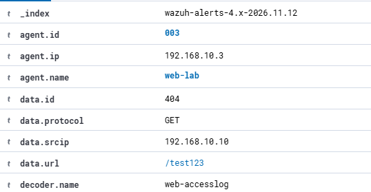
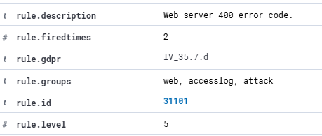

# Wazuh Agent — подключение и мониторинг Nginx
## 1. Цель

Подключить Ubuntu Server к Wazuh SIEM, настроить сбор логов Nginx и проверить обнаружение HTTP-событий.
## 2. Лабораторный стенд

- Kali Linux — `192.168.10.10`

- Ubuntu Server (Nginx) — `192.168.10.3`

- Wazuh Manager — `192.168.10.1`
## 3. Установка Wazuh Agent

Проверили доступность Wazuh Manager по TCP-порту `1514`.

Установили Wazuh Agent, указали адрес менеджера `192.168.10.1`, настроили автозапуск и проверили состояние службы.

Агент `web-lab` успешно подключился к Wazuh Manager, статус — `Active`.

## 4. Настройка сбора логов Nginx

В `/var/ossec/etc/ossec.conf` добавили два источника:

- `/var/log/nginx/access.log` — формат `apache`.

- `/var/log/nginx/error.log` — формат `syslog`.

После настройки перезапустили агент.
## 5. Проверка обнаружения HTTP-события

С Kali отправили HTTP GET-запрос на несуществующий ресурс `/test123`.

Nginx вернул `404 Not Found`.

В Wazuh обнаружили соответствующее событие:

- Источник: `192.168.10.10`

- Метод: `GET`

- URL: `/test123`

- Код ответа: `404`

- Декодер: `web-accesslog`

Сработало правило:

- ID: `31101`

- Description: `Web server 400 error code.`

- Level: `5`

## 6. Вывод

Успешно подключили Ubuntu Server к Wazuh и настроили сбор журналов Nginx.

Подтвердили передачу HTTP-события от веб-сервера в SIEM, работу декодера `web-accesslog` и срабатывание правила `31101`.